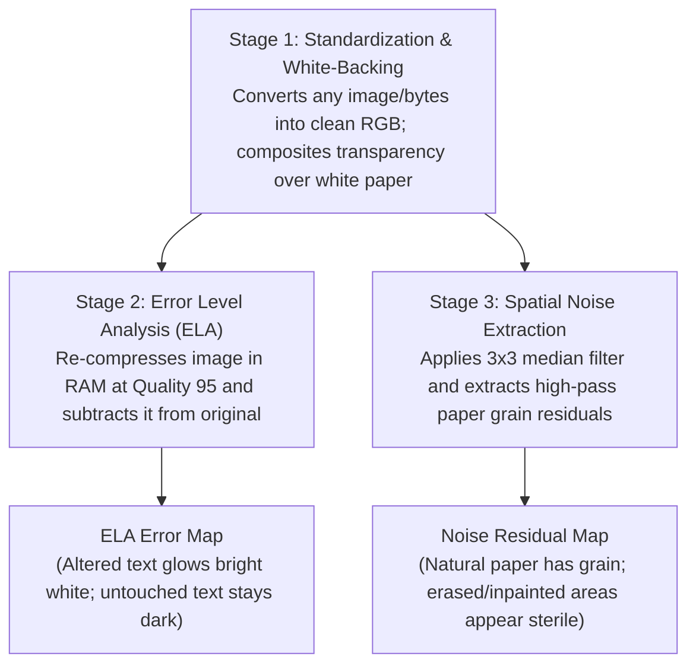

# DocGuard — Module 1 Pedagogical & Technical Guide
## Understanding the In-Memory Forensic Preprocessor

---

## 1. What is Module 1 Doing? (The Objective in Simple Language)

Imagine someone hands you a printed medical receipt where the total amount has been altered from **₹4,000** to **₹14,000** using Photoshop or an AI photo editor. 

To your eyes, the numbers look completely normal. Optical Character Recognition (OCR) simply reads "₹14,000". And because you do not have the clinic's original reference copy, you cannot compare it against anything.

**Module 1 is the forensic investigator that looks underneath the surface of the image.**

Its primary mission is **Forensic Signal Extraction**:
Before passing a document to deep learning neural networks, Module 1 extracts two hidden physical signatures that humans cannot see, but which prove whether an image has been digitally altered:

1. **Compression Equilibrium Discrepancies**: It checks if different parts of the document have been saved and compressed at different times (revealing newly pasted or modified numbers).
2. **Paper Grain & Noise Discontinuities**: It checks if the microscopic physical paper texture is continuous across the page, or if certain areas are unnaturally smooth (revealing AI inpainting or digital erasing).

All of this is performed **100% in system memory (RAM)** so the system runs in milliseconds without creating temporary files or locking errors on Windows.

---

## 2. How Does Module 1 Achieve This? (Step-by-Step Workflow)

Module 1 accomplishes its objective through a three-stage pipeline:

### Stage 1: Input Normalization & Safety
Documents arrive in all shapes and formats: phone photos, PDF pages, transparent PNGs, or raw bytes sent from a web browser. Module 1 ensures:
* Non-standard color modes are converted to standard 3-channel RGB.
* Transparent document areas are blended onto pure white paper backing rather than turning black.
* Smartphone photos taken sideways are physically rotated upright using camera orientation metadata.

### Stage 2: Error Level Analysis (ELA)
* The image is re-compressed in memory as a JPEG at baseline Quality 95.
* The original image and the re-compressed image are subtracted from each other pixel-by-pixel.
* Original parts of the document that were already compressed do not change much (they stay dark).
* Newly edited numbers (which had never been compressed at Quality 95) undergo active compression loss and **glow bright white**.

### Stage 3: Spatial Noise Residual Extraction
* The image is passed through a $3 \times 3$ median filter. This removes microscopic grain while leaving the letters and lines intact.
* By subtracting this smoothed image from the original, we isolate pure high-frequency texture (paper fiber grain and scanner sensor noise).
* If someone erased a stamp or infilled text using an AI inpainting tool, that region has zero grain and appears completely "sterile", revealing the fraud.

---

## 3. Comprehensive Glossary of Technical & ML Concepts

Below is an exhaustive explanation of every technical keyword, forensic principle, and machine learning concept used in Module 1.

---

### Category A: Digital Image Fundamentals & Color Spaces

#### 1. Pixels & Color Channels
* **What is a Pixel?**: The smallest individual colored dot in a digital picture. A standard document image of $600 \times 400$ contains 240,000 pixels arranged in a 2D grid.
* **RGB (Red, Green, Blue)**: The standard digital color representation. Every pixel is composed of 3 integer numbers from $0$ to $255$:
  * $(255, 255, 255)$: Pure White (clean paper).
  * $(0, 0, 0)$: Pure Black (printed ink).
  * $(255, 0, 0)$: Pure Red.
* **Tensors**: In deep learning, an image is stored as a multi-dimensional array of numbers called a **Tensor**. For example, a shape of $(3, 512, 512)$ represents 3 color channels (RGB) across 512 rows and 512 columns.

#### 2. Alpha Channel & Transparency
* **What is Alpha?**: A 4th channel added to RGB (making it `RGBA`) that controls transparency from $0$ (completely invisible) to $255$ (completely solid).
* **The "Black Border" Danger in Forensics**:
  * Scanned forms or digital stamps often have transparent backgrounds.
  * If software converts an RGBA image to RGB using standard methods, transparent pixels automatically turn pitch black $(0, 0, 0)$.
  * In a document, this creates an extreme jump from white paper $(255, 255, 255)$ to black $(0, 0, 0)$. 
  * Convolutional Neural Networks (CNNs) look for sharp edge boundaries; they will mistake this black border for a spliced rectangular patch, triggering a **false positive**.
* **Alpha Compositing on White**:
  * Module 1 creates an imaginary sheet of white paper and mathematically blends the document over it. Transparent regions become white paper, exactly as they would appear in the real world.

#### 3. EXIF Metadata & Orientation Transposition
* **EXIF (Exchangeable Image File Format)**: Hidden metadata saved by smartphone cameras inside photo files (recording date, shutter speed, camera model, and device orientation).
* **The Orientation Trap**: When you hold your phone vertically to photograph a receipt, the camera sensor records the pixels horizontally and simply writes a tag: `"Orientation: Rotate 90°"`.
* If an AI model reads the raw pixel array without checking this tag, it sees the document sideways. Neural networks trained to detect horizontal lines of text fail completely.
* **Transposition**: Module 1 physically rotates the pixel array so the document is upright before any analysis occurs.

---

### Category B: Compression Physics & Error Level Analysis (ELA)

#### 4. Lossless vs. Lossy Compression
* **Lossless Compression (PNG, TIFF)**: Compresses file size using pattern matching (like a ZIP file) without altering a single pixel. Perfect quality, but large file size.
* **Lossy Compression (JPEG)**: Reduces file size by permanently discarding image details that the human eye is less sensitive to. Every time a JPEG is saved, information is lost.

#### 5. Discrete Cosine Transform (DCT) & Frequency Domain
* **Spatial Domain**: Looking at an image as pixels at coordinates $(x, y)$.
* **Frequency Domain**: Looking at an image as a combination of smooth transitions (low frequencies) and sharp changes (high frequencies).
* **How JPEG Uses DCT**:
  * The image is chopped into small $8 \times 8$ pixel squares.
  * Each square is mathematically converted into 64 frequency waves using the **Discrete Cosine Transform (DCT)**.
  * Low-frequency waves represent the overall brightness of the paper. High-frequency waves represent sharp edges of printed letters.

#### 6. Quantization & Quantization Matrices
* **Quantization**: The step where JPEG permanently throws away data.
* The 64 frequency numbers are divided by numbers from a standard "Quantization Table" and rounded to whole integers. Fractional values are erased.
* High frequencies are divided by large numbers, turning most of them into zeros. This is why JPEG files are so small.

#### 7. Quantization Equilibrium
* **The Natural Law of Re-Saving**: If you take an unedited JPEG image and save it again at the exact same quality level (e.g. Quality 95), the pixels have *already* been divided by that table.
* Because the numbers are already multiples of the divisor, dividing them again causes virtually zero rounding error.
* The difference between the image before and after re-saving is almost zero ($\Delta \approx 0$). This state of stability is called **Quantization Equilibrium**.

#### 8. The ELA Tampering Anomaly
* Suppose someone modifies an invoice total from ₹4,000 to ₹14,000 in an image editor and saves the document.
* The untouched text is in equilibrium from earlier saves.
* But the new digits ("14,000") are being compressed for the **very first time** at that specific location.
* When Module 1 compresses the whole document in memory at Quality 95 and subtracts it from the original:
  $$\Delta(x, y) = |I_{\text{original}}(x, y) - I_{\text{resaved}}(x, y)|$$
  * Untouched text has already settled into equilibrium $\to$ produces near-zero difference $\to$ **remains dark**.
  * The altered "14,000" undergoes active first-time compression $\to$ produces a large error delta $\to$ **glows bright white**.

#### 9. Dynamic Range Amplification (Scaling)
* Raw compression errors are tiny (values between 1 and 15 out of 255), which appear very faint to humans.
* Module 1 multiplies the difference by an amplification factor (e.g., $15\times$) and caps values at 255. This expands the subtle error into the full visible range $[0, 255]$ so both humans and neural networks can immediately see the alteration.

---

### Category C: Spatial Noise, Filtering & AI Inpainting

#### 10. Sensor Shot Noise, Thermal Noise & Paper Grain
* **Photon Shot Noise & Thermal Noise**: Physical cameras and document scanners convert light into electrical voltage. Tiny fluctuations in temperature and light particles produce microscopic, random pixel variations.
* **PRNU (Photo-Response Non-Uniformity)**: Microscopic physical imperfections unique to each silicon camera sensor. It acts like an invisible digital fingerprint stamped onto every scanned page.
* **Paper Grain**: The random microscopic texture of physical cellulose wood fibers in authentic paper.

#### 11. Linear Filtering (Gaussian Blur) vs. Non-Linear Filtering (Median Filter)
* **Linear Filtering (Gaussian Blur)**: Averages neighboring pixels together.
  * *Why it fails in forensics*: When it hits the sharp black edge of a letter on white paper, it blends black and white into gray. When you subtract the blur, it creates massive fake halos around every character, drowning out the real noise.
* **Non-Linear Filtering (Median Filter)**: Sorts all neighboring pixels in a $3 \times 3$ window from lowest to highest and picks the **middle value**.
  * *Why it succeeds*: It ignores extreme isolated noise dots while keeping sharp character edges crisp and intact. It is called **Edge-Preserving Filtering**.

#### 12. Spatial Noise Residual
* By subtracting the median-filtered image from the original image:
  $$R(x, y) = |I(x, y) - I_{\text{smooth}}(x, y)|$$
  all printed text, tables, and logos cancel out, leaving **pure high-frequency noise and paper grain**.

#### 13. The "Sterile Patch" Anomaly (Catching AI Inpainting & Erasure)
* When an attacker uses Adobe Photoshop "Content-Aware Fill" or Generative AI (like Stable Diffusion Inpainting) to erase an unwanted stamp or signature:
  * The AI algorithm paints over the area with smooth, mathematically calculated colors.
  * However, **the AI cannot replicate the microscopic random grain of the physical scanner or paper fibers**.
* In the noise residual map $R(x, y)$:
  * Genuine paper has a healthy noise level ($\text{mean} \approx 5.7$).
  * The erased/inpainted area has virtually zero noise ($\text{mean} = 0.0$).
* This drop in local noise variance ($\sigma^2 \to 0$) unmasks the alteration immediately, even if the colors match the background perfectly!

---

### Category D: Machine Learning & Deep Learning Terminology

#### 14. Why Raw RGB Confuses Standard Neural Networks
* If you train a standard convolutional neural network (like ResNet) directly on raw RGB document images, the network quickly learns to recognize invoice templates, company logos, and English words.
* It often **overfits** to document layouts rather than learning how to spot forgeries. It might accuse a genuine document of being fake simply because it has never seen that clinic's logo before.

#### 15. Inductive Bias & Feature Decoupling
* **Inductive Bias**: Giving a machine learning model domain-specific clues that guide it toward the right solution rather than forcing it to guess from scratch.
* **Feature Decoupling**: By extracting ELA compression maps and noise residuals in Module 1, we decouple the forensic physics from the visual semantics:
  * **Stream 1 (EfficientNet-B0)** receives the ELA map, forcing its filters to look strictly at compression physics.
  * **Stream 2 (ResNet-50)** receives the RGB image, focusing on font alignment and edge seams.
* Combining both streams gives the system superhuman detection accuracy while preventing false alarms.

#### 16. Out-of-Distribution (OOD) & Zero-Shot Detection
* **Out-of-Distribution**: When an AI model encounters an editing tool or document type it was never trained on.
* Because Module 1 relies on physical laws (JPEG quantization math and sensor noise physics) rather than memorized visual templates, it can catch tampering performed by brand-new AI editors that did not even exist when the model was trained.

---

### Category E: Operating System Architecture & In-Memory Streaming

#### 17. In-Memory Virtual Streams (`io.BytesIO`)
* A standard file operation writes bytes to a physical hard drive or SSD (`C:\temp\image.jpg`).
* `io.BytesIO` creates a **virtual file inside your computer's high-speed RAM**. Python treats it exactly like a real file on disk, but it never touches physical storage.

#### 18. Windows File Locking (`WinError 32`)
* On Windows, when a program opens a file on disk, the operating system locks it. If another thread, background process, or antivirus scanner tries to read or delete that file simultaneously, Windows crashes with:
  `WinError 32: The process cannot access the file because it is being used by another process.`
* By performing 100% of Module 1's operations in RAM via `io.BytesIO`, DocGuard completely eliminates disk latency and Windows file-locking crashes.

---

## 4. Summary: How Module 1 Enables the Rest of DocGuard

| Signal Extracted | Physical Principle Used | What It Detects | Downstream Consumer |
|:---|:---|:---|:---|
| **Clean RGB Image** | Alpha-compositing & EXIF transposition | Eliminates false border spikes and sideways scans | Stream 2 (ResNet-50) & Visual UI |
| **ELA Difference Map** | JPEG quantization equilibrium | Modified amounts, pasted digits, altered dates | Stream 1 (EfficientNet-B0) |
| **Noise Residual Matrix** | Non-linear median filter subtraction | Erased stamps, deleted text, AI inpainting | Decision Fusion Brain & Bounding Box Localizer |
