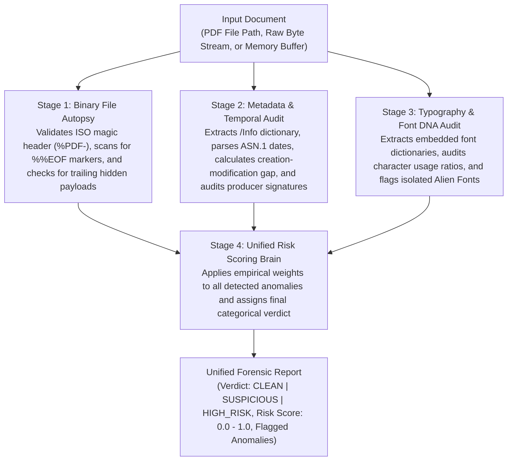

# DocGuard — Module 2 Pedagogical & Technical Guide
## Understanding the Native PDF & Metadata Forensic Engine

---

## 1. What is Module 2 Doing? (The Objective in Simple Language)

Imagine a fraudster wants to tamper with an electronic medical bill or bank statement in PDF format. Instead of printing it out, scanning it, or using complex photo manipulation software, they open the PDF in an online editor like *iLovePDF* or *Canva*, click on the total amount `INR 4,000`, type `INR 14,000`, and hit **Save**.

To human eyes reading the document on a screen, the PDF looks completely crisp, sharp, and authentic. There are no pixel blurs, no low-resolution artifacts, and no obvious visual flaws.

**Module 2 is the low-level forensic investigator that inspects the file's internal DNA and digital paper trail.**

Before a single pixel is ever rendered or passed to neural networks, Module 2 performs a deep structural autopsy on the PDF file itself:
1. **Physical File Structure (Binary Autopsy)**: It checks whether the file has been edited and re-saved after its initial creation, exposing hidden revisions and appended data.
2. **Digital Timestamp & Authoring Audit (Metadata Forensics)**: It checks who created the file, what software generated it, and whether the internal timestamps are physically possible.
3. **Typographical Uniformity (Font DNA)**: It examines the embedded fonts inside the document to determine if the numbers in the "Grand Total" were typed using a different, injected font than the rest of the text.
4. **Calibrated Forensic Scoring (Unified Brain)**: It fuses these independent physical indicators into a single mathematical risk score ranging from **0.0 (Clean)** to **1.0 (Tampered)**.

---

## 2. How Does Module 2 Achieve This? (Step-by-Step Workflow)

Module 2 evaluates the document through a four-stage forensic pipeline:

### Stage 1: Native PDF Binary Autopsy
* Validates that the file starts with the ISO magic header `%PDF-`.
* Scans the raw byte stream from the end of the file backwards to locate `%%EOF` (End of File) markers and `startxref` pointers.
* Detects **Incremental Updates**: If multiple `%%EOF` markers exist, the file was modified and re-saved in separate editing sessions.
* Detects **Trailing Payloads**: Checks whether unauthorized bytes, hidden scripts, or malicious attachments were appended after the final `%%EOF` marker.

### Stage 2: Metadata Integrity & Timestamp Audit
* Extracts the internal `/Info` and XMP metadata dictionaries without relying on operating system file timestamps (which change whenever a file is copied).
* Decodes standardized ASN.1 date strings into exact UTC timestamps.
* Calculates the **Temporal Modification Gap ($\Delta t$)**:
  * An automated billing system generates and modifies an invoice within milliseconds ($\Delta t \approx 0$).
  * If $\Delta t$ spans days or months, human editing occurred.
  * If $\Delta t < 0$ (Modified date is *earlier* than Creation date), timestamp spoofing or date tampering is mathematically confirmed.
* Cross-references `/Producer` and `/Creator` software tags against blacklists of consumer editing tools (*iLovePDF, Sejda, Canva, Photoshop*) and whitelists of enterprise ERP engines (*ReportLab, SAP, Tally*).

### Stage 3: Typographical & Font Embedding Audit
* Inspects low-level font descriptors and character distributions across every text span on every page.
* Computes character usage ratios across font families.
* Identifies **Alien Font Injections**: If an entire invoice is typeset in Helvetica, but the numbers in `"INR 14,000"` are rendered with an isolated Courier or Arial font, it flags selective text alteration.
* Identifies **Font Explosions**: Documents featuring an unnaturally chaotic variety of font families on a single page.
* Recognizes **Image-Only Scans**: Flat bitmap documents where vector text has been stripped or flattened.

### Stage 4: Calibrated Multi-Vector Risk Scoring
* Takes all detected anomalies from Stages 1, 2, and 3 and applies a calibrated empirical weighting model:
  $$\text{Risk Score} = \min\left(1.0, \sum w_i \cdot \mathbf{1}_{\text{anomaly}_i}\right)$$
* Categorizes the document into three distinct operational states:
  * **CLEAN ($0.0$)**: Untouched, authentic document.
  * **SUSPICIOUS ($0.0 < \text{Score} < 0.6$)**: Non-critical discrepancy detected; requires human audit.
  * **HIGH_RISK ($\ge 0.6$)**: Severe compounding anomalies or physical tampering signatures detected.

---

## 3. Comprehensive Glossary of Technical, Forensic & ML Concepts

---

### A. PDF Binary Architecture & ISO 32000-1 Standards

#### 1. ISO 32000-1 Specification
* **What it is**: The official international standard governing the digital Portable Document Format (PDF). It defines how objects (text, fonts, vectors, images) are structured, compressed, cross-referenced, and terminated inside a file.
* **Why it matters in forensics**: Because ISO 32000-1 strictly defines how authentic PDF engines must write files, any non-standard deviations, unusual marker positions, or invalid table pointers serve as hard physical proof of tampering.

#### 2. The Magic Byte Header (`%PDF-`)
* **What it is**: The first 5 to 8 bytes of every valid PDF file (e.g., `%PDF-1.4` or `%PDF-1.7`).
* **Why it matters in forensics**: Many file upload systems merely check file extensions (`.pdf`). Fraudsters sometimes rename executable scripts or corrupted files to `.pdf`. Checking for the `%PDF-` magic header within the first 1024 bytes confirms that the file is genuinely a PDF before processing.

#### 3. Incremental Updates & Multiple `%%EOF` Markers
* **What it is**: The PDF specification was designed so that large documents could be edited quickly without rewriting the entire file. When a user edits a PDF, instead of replacing existing objects, the software appends new objects, an updated cross-reference table, and a new `%%EOF` (End Of File) marker at the end of the original file.
* **The Forensic Signature**:
  * An authentic, freshly generated invoice from an enterprise billing engine (like SAP or ReportLab) is written in a single pass and contains **exactly one `%%EOF` marker**.
  * If a document contains **two or more `%%EOF` markers**, it proves that the document was modified in a second (or third) distinct saving session after its initial generation. In financial auditing, this is often the exact digital footprint left when someone re-saves a signed invoice.

#### 4. The Cross-Reference Table (`xref`) and `startxref` Pointer
* **What it is**: A PDF file is not read sequentially from top to bottom like a text file; it is a random-access database of numbered objects. The `xref` table is an index that lists the exact byte offset of every object in the file. The `startxref` keyword, located just before `%%EOF`, tells the PDF reader where to find this index.
* **Why it matters in forensics**: When an incremental update occurs, a new `startxref` pointer is written to point to the newest revision's object table. By counting and comparing `startxref` pointers against `%%EOF` markers, DocGuard uncovers hidden revision branches.

#### 5. Trailing Hidden Payloads (Post-EOF Data Injection)
* **What it is**: Standard PDF readers stop reading a file once they encounter the final `%%EOF` marker. Any bytes written after that marker are completely invisible to regular users viewing the document.
* **Why it matters in forensics**: Fraudsters and malware authors take advantage of this behavior to append unreferenced secondary documents, private encryption keys, or malicious executable payloads. DocGuard scans beyond the final `%%EOF` marker; if more than 32 bytes of non-whitespace data exist, it raises a critical structural alarm.

---

### B. Metadata & Temporal Forensic Analysis

#### 1. Document Information Dictionary (`/Info`)
* **What it is**: An internal dictionary embedded in the PDF catalog containing standardized metadata fields:
  * `/CreationDate`: The date and time the document was first synthesized.
  * `/ModDate`: The date and time the document was last modified.
  * `/Producer`: The underlying software library that compiled the PDF (e.g. `ReportLab`, `Quartz PDFContext`, `iText`).
  * `/Creator`: The application that created the original content (e.g. `Microsoft Word`, `SAP ERP`, `Canva`).
* **Why it matters in forensics**: Operating system timestamps (such as Windows "Date Created" or "Date Modified") change whenever a file is emailed, downloaded, or copied to a USB drive. Internal `/Info` metadata travels inside the file itself, preserving the true digital history of the document.

#### 2. ASN.1 Timestamp Encoding
* **What it is**: The International Telecommunication Union's Abstract Syntax Notation One (ASN.1) standard used by PDFs to encode timestamps. It follows the format:
  $$\text{D:YYYYMMDDHHmmSS[+|-]HH'mm'}$$
  For example, `D:20261030143000+05'30'` represents October 30, 2026, at 14:30:00 with a timezone offset of +5 hours and 30 minutes.
* **Why it matters in forensics**: DocGuard parses these strings into timezone-aware datetime objects, allowing precise mathematical calculations down to the exact second regardless of what timezone the auditor is sitting in.

#### 3. Temporal Modification Gap ($\Delta t$)
* **What it is**: The elapsed duration between when the document was initially created and when it was last modified:
  $$\Delta t = \text{ModDate} - \text{CreationDate}$$
* **The Forensic Rule**:
  * In legitimate automated accounting workflows, documents are compiled and finalized in a single automated step. $\Delta t$ is typically less than 60 seconds.
  * If $\Delta t > 86,400\text{ seconds}$ (more than 1 day), the document was reopened and re-saved long after issuance, indicating manual human intervention.

#### 4. Impossible Temporal Inversion (Negative Time Gap)
* **What it is**: A state where the recorded modification date occurs *before* the recorded creation date:
  $$\text{ModDate} < \text{CreationDate} \quad (\Delta t < -60\text{s})$$
* **Why it matters in forensics**: In the physical universe, a file cannot be modified before it is created. When $\Delta t$ is negative, it is definitive mathematical proof of metadata forgery: a fraudster attempted to manipulate the dates to make an altered invoice look older than it actually is, but failed to adjust both fields synchronously.

#### 5. Software Fingerprinting: Whitelisting vs. Blacklisting
* **What it is**: Categorizing software engines based on their typical role in enterprise document lifecycles.
* **Enterprise Whitelist**: Automated billing, banking, and ERP engines that generate pristine, non-interactive documents:
  * `ReportLab`, `SAP`, `Tally`, `Oracle NetSuite`, `QuickBooks`, `JasperReports`, `Apache FOP`.
* **Consumer Blacklist**: Web-based editors and design tools designed for casual human modification:
  * `iLovePDF`, `Sejda`, `Smallpdf`, `Canva`, `Adobe Photoshop`, `Nitro Pro`, `Foxit PhantomPDF`.
* **Why it matters in forensics**: An invoice claiming to be an authentic corporate hospital bill whose internal `/Producer` tag reads `"iLovePDF Online Document Editor"` or `"Canva"` is an immediate giveaway of post-issuance tampering.

---

### C. Typography & Font DNA Forensics

#### 1. Embedded Font Dictionaries
* **What it is**: When a PDF contains text, it references font dictionaries that define character glyph shapes, widths, encodings, and metrics.
* **Standard 14 Base Fonts**: The PDF specification includes standard built-in fonts (`Helvetica`, `Times-Roman`, `Courier`, `Symbol`, `ZapfDingbats`) that all PDF readers can display without embedding full font files.
* **Embedded Fonts**: Custom corporate typefaces whose actual TrueType/OpenType font program files are embedded directly inside the PDF stream.

#### 2. The "Alien Font Injection" Signature
* **What it is**: When an attacker opens a PDF in an editor to alter a specific number or date, the editing software must select a font to render the new characters. In many cases:
  * The editor does not have access to the exact embedded font used by the original billing software.
  * The editor creates a **brand-new font dictionary** or substitutes a system font (such as standard `Courier` or `Arial`) solely for that one altered text box.
* **The Forensic Signature**:
  * DocGuard inspects every text span across the document, measuring the character count associated with each font family.
  * If a document has a dominant primary font that accounts for $> 50\%$ of all characters, but has an isolated minority font accounting for $< 35\%$ of characters, DocGuard flags an **Alien Font Insertion**.
  * Crucially, DocGuard extracts the exact text rendered by that alien font (e.g., `"Grand Total: INR 14,000"`), providing undeniable proof of selective alteration.

#### 3. Typographical Font Explosion
* **What it is**: A document containing an excessive variety of unrelated font families ($\ge 4$) on a single page.
* **Why it matters in forensics**: Professional corporate templates are strictly designed with consistent typographic hierarchies (usually 1 header font and 1 body font). A chaotic mixture of multiple font families indicates composite splicing, where content from multiple distinct source documents has been pasted together.

#### 4. Flattened Scanned Document Recognition
* **What it is**: A PDF that contains zero vector text elements and zero embedded fonts, consisting entirely of a single raster image embedded on the page.
* **Why it matters in forensics**: Attackers frequently "flatten" tampered PDFs into images to erase all metadata, font dictionaries, and incremental update markers. DocGuard recognizes this state and automatically alerts downstream modules to rely primarily on visual and pixel-level forensic streams (Module 1 ELA, ResNet-50, and EfficientNet-B0).

---

### D. Mathematical Fusion & Machine Learning Connections

#### 1. Multi-Vector Risk Fusion
* **The Problem**: No single forensic test is $100\%$ infallible on its own. For example, an authentic invoice might legitimately have two revisions if a clerk added an official signature, or a minor typographical variance might be part of an old template.
* **The Solution**: Multi-Vector Fusion. By gathering signals across three distinct physical planes (Binary, Metadata, Typography) and computing an aggregated risk score, the system drastically reduces false positives while catching sophisticated tamper attempts that try to conceal their tracks in one plane but leave traces in another.

#### 2. Mathematical Risk Formulation
The risk engine computes an empirical score $S_{\text{risk}} \in [0.0, 1.0]$:
$$S_{\text{risk}} = \min\left(1.0, \sum_{i=1}^M w_i \cdot \mathbf{1}_{A_i}\right)$$
Where:
* $A_i$ represents the $i$-th forensic anomaly condition.
* $\mathbf{1}_{A_i} \in \{0, 1\}$ is an indicator function that evaluates to $1$ if anomaly $A_i$ is present, and $0$ otherwise.
* $w_i$ is the empirical weight assigned to that anomaly based on its forensic severity:

| Anomaly Indicator ($A_i$) | Weight ($w_i$) | Forensic Justification |
|:---|:---:|:---|
| **Incremental Update ($N_{\text{EOF}} \ge 2$)** | **0.40** | Physical proof of a secondary post-creation saving session |
| **Blacklisted Consumer Software** | **0.35** | Document passed through an interactive editing tool (e.g. iLovePDF) |
| **Alien Font Injection** | **0.30** | Isolated typography used specifically for altered text fragments |
| **Temporal Forgery ($\text{Mod} < \text{Create}$)** | **0.35** | Physically impossible timestamp order (deliberate date spoofing) |
| **Post-Creation Gap ($\Delta t > 1\text{ day}$)** | **0.25** | Document was re-saved long after the original generation event |
| **Hidden Trailing Data** | **0.25** | Unreferenced bytes appended past the final %%EOF delimiter |
| **Font Explosion ($\ge 4$ fonts)** | **0.20** | Typographic inconsistency indicating document splicing |
| **Stripped Metadata** | **0.15** | Complete absence of standard /Info metadata headers |

#### 3. Connection to Bayesian Priors in Machine Learning
* In a classical Bayesian classification framework, the posterior probability of tampering $P(\text{Tampered} | \mathbf{x})$ depends on the prior probability $P(\text{Tampered})$ and the likelihood of the visual features $P(\mathbf{x} | \text{Tampered})$.
* In DocGuard, the **Metadata Risk Score acts as an informed physical prior**:
  * If a document has $S_{\text{risk}} = 0.80$ (multiple structural tampering indicators), the deep learning vision network does not start from a naive $50/50$ guess; it is informed that the physical carrier file is already compromised.
  * Conversely, if $S_{\text{risk}} = 0.00$, the vision network requires significantly stronger visual pixel evidence before raising a false alarm.

#### 4. Explainable AI (XAI) & Auditability
* Deep learning models (like CNNs or Vision Transformers) often act as "black boxes", outputting a single prediction probability without explaining *why*.
* In legal and court-grade forensic auditing, a black-box percentage is not legally defensible on its own.
* Module 2 provides **100% Explainable Forensics**:
  * Every point added to the risk score is accompanied by an exact, deterministic human-readable reason (e.g., `"Detected isolated font 'Courier' accounting for 26.6% of text (Grand Total: INR 14,000) while primary typography is 'Helvetica'"`).
  * This ensures that DocGuard's reports can be directly submitted to insurance adjusters, compliance officers, and judicial authorities.

---

### Summary Table: How Module 2 Signals Protect the System

| Forensic Signal | Layer Inspected | What It Detects | Target Consumer |
|:---|:---|:---|:---|
| **`%%EOF` Count & Offsets** | Raw Byte Stream | Post-issuance saving sessions, hidden revisions | Risk Engine & Audit Report |
| **Trailing Byte Count** | Post-EOF Bytes | Appended payloads, hidden files, trailing malware | Risk Engine & Security Warning |
| **ASN.1 Date Delta ($\Delta t$)** | Metadata (`/Info`) | Human editing sessions, date manipulation | Risk Engine & Temporal Timeline |
| **Software Signatures** | `/Producer`, `/Creator` | Consumer editing tools (iLovePDF, Canva) | Risk Engine & Tool Warning |
| **Font Span Character Ratios** | Text Span Dictionaries | Alien font insertions, spliced amounts | Risk Engine & Text Localizer |
| **Calibrated Risk Score** | Unified Aggregator | Holistic structural health (0.0 to 1.0) | Stream 3 (Decision Fusion Brain) |
