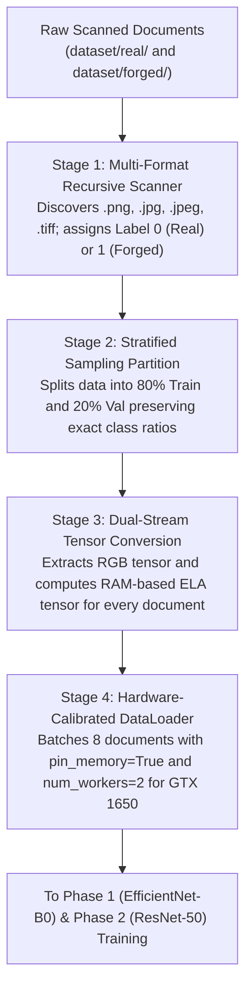

# DocGuard — Module 3 Pedagogical & Technical Guide
## Understanding the Real Dataset Loader & Stratified Splitter

---

## 1. What is Module 3 Doing? (The Objective in Simple Language)

Imagine you want to train an intelligent forensic investigator (a deep neural network) to detect altered invoices, receipts, and bank statements. 

To train an AI model effectively, you need thousands of document examples divided into two categories: **Authentic (Genuine)** and **Forged (Tampered)**. But machine learning models do not learn directly from raw image files scattered in random folders on a hard drive. Neural networks speak only one language: **multidimensional arrays of numbers (mathematical tensors)**.

Furthermore, how you feed those documents into the AI determines whether it succeeds in the real world or fails completely:
* If you give the AI 90% authentic documents and only 10% forged documents, it becomes lazy and learns to guess "authentic" every time.
* If you train the AI only on clean synthetic computer graphics, it gets confused when it encounters real-world documents with scanner dust, folds, and paper textures.
* If a document from the training set accidentally leaks into the test set, the AI merely memorizes the answer like a cheating student rather than learning real forensic reasoning.

**Module 3 is the intelligent logistics coordinator and data pipeline.**

Its objective is to organize, partition, transform, and stream document data into the deep neural networks:
1. **Real-World Document Ingestion**: It organizes genuine documents into `dataset/real/` and tampered documents into `dataset/forged/`.
2. **Stratified 80/20 Partitioning**: It mathematically splits the data into 80% for Training and 20% for Validation while strictly guaranteeing that the percentage of real vs. forged files is identical in both sets.
3. **Dual-Stream Tensor Packaging**: For every single document, it packages two distinct views: a clean RGB image for visual inspection and an in-memory Error Level Analysis (ELA) map for compression physics inspection.
4. **Forensic-Safe Augmentations**: It introduces subtle real-world variations (slight scanner rotations and lighting shifts) while strictly avoiding destructive changes (like flipping text backwards).
5. **Hardware-Tuned GPU Streaming**: It streams data into the NVIDIA GeForce GTX 1650 in bite-sized batches ($8$ images at a time) using direct page-locked memory, ensuring the GPU stays fully fed without running out of its 4 GB VRAM limit.

---

## 2. How Does Module 3 Achieve This? (Step-by-Step Workflow)

Module 3 processes data through a four-stage pipeline:

### Stage 1: Recursive File Discovery & Class Mapping
* Traverses the `dataset/` root directory to locate all supported image formats.
* Assigns standardized binary target labels: **$0$ for Authentic / Real** and **$1$ for Forged / Tampered**.
* If folders are empty, it prints friendly terminal instructions guiding the user on where to place their documents.

### Stage 2: Stratified 80/20 Train/Validation Split
* Rather than rolling dice with random assignment, it uses stratified sampling to partition the dataset.
* 80% of documents are reserved for teaching the network (Training Set), and 20% are sealed away to measure true performance (Validation Set).
* Strictly enforces **zero data leakage**: no document or variation of a document exists in both sets simultaneously.

### Stage 3: Dual-Stream Tensor Generation (`DocGuardDataset`)
* For each document, it generates two synchronized PyTorch tensors:
  * **Stream 1 (ELA Tensor)**: The document is re-compressed in RAM at Quality 95 via Module 1 to produce an ELA compression delta map, resized to $(3, 224, 224)$.
  * **Stream 2 (RGB Tensor)**: The raw document is normalized, composites transparency over white paper, and scaled to $(3, 224, 224)$.
* Both tensors undergo ImageNet $z$-score normalization to match the mathematical expectations of pre-trained convolutional backbones.

### Stage 4: Hardware-Calibrated Streaming (`DataLoader`)
* Groups individual documents into mini-batches of $8$.
* Uses `num_workers = 2` on 4-core Windows CPUs to prepare the next batch in RAM while the GPU is processing the current one.
* Uses CUDA page-locked memory (`pin_memory = True`) for direct, high-speed Direct Memory Access (DMA) streaming over the PCIe bus into the GTX 1650 GPU.

---

## 3. Comprehensive Glossary of Technical & ML Concepts

---

### A. Dataset Architecture & Domain Adaptation

#### 1. The Synthetic-to-Real Domain Gap
* **What it is**: The fundamental performance drop that occurs when a machine learning model is trained on computer-generated (synthetic) data but tested on real-world data.
* **Why it matters in document forensics**:
  * A synthetic invoice created by copying and pasting pixels in a script has razor-sharp, mathematically perfect edges and clean digital borders.
  * A real-world scanned invoice has physical scanner sensor noise, microscopic paper fiber grain, ink bleed, subtle shadows from paper folds, and lens optical distortions.
  * If an AI only sees synthetic forgeries during training, it overfits to synthetic artifacts. When deployed in a bank or hospital to inspect real scanned documents, it fails. Training on real-world scanned documents bridges this gap, allowing convolutional filters to learn organic forensic features.

#### 2. Binary Ground Truth Labeling ($0$ vs. $1$)
* **What it is**: The numeric encoding used to represent categorical outcomes in binary classification.
* **DocGuard Standard**:
  * $\mathbf{Y = 0}$: **Authentic / Real** (Untouched, legitimate document issued by an institution).
  * $\mathbf{Y = 1}$: **Forged / Tampered** (Digitally altered, manipulated, spliced, or inpainted document).
* These scalar targets are mapped to cross-entropy loss functions during neural network training.

---

### B. Statistical Partitioning & Data Splitting

#### 1. The 80/20 Train/Validation Split Rule
* **What it is**: The machine learning practice of dividing available historical data into two strictly separated sets:
  * **Training Set ($80\%$)**: The textbook the AI studies. Model weights and convolutional kernels are actively updated via gradient descent based on this data.
  * **Validation Set ($20\%$)**: The final exam. The AI never sees this data during gradient updates; it is used exclusively to evaluate whether the model has truly learned general forensic principles or merely memorized the training images.

#### 2. Stratified Sampling vs. Naive Random Splitting
* **What it is**:
  * In **naive random splitting**, documents are assigned to train or validation purely by chance (like flipping a coin). On small or moderate datasets, coin flips often produce an accidental class imbalance (e.g. 70% real in training, but only 30% real in validation).
  * In **stratified sampling**, the algorithm calculates the exact proportion of real vs. forged documents in the full dataset ($p$) and guarantees that both the training set and the validation set contain that exact same ratio:
    $$P(\text{Class} = \text{Real} \mid \text{Train}) = P(\text{Class} = \text{Real} \mid \text{Val}) = P(\text{Class} = \text{Real} \mid \text{Full})$$
* **Why it matters in forensics**: Stratification prevents class distribution drift, ensures validation accuracy is an honest metric, and keeps the model's decision threshold properly calibrated.

#### 3. Data Leakage Prevention (Disjoint Partitions)
* **What it is**: The catastrophic error where information from the validation or test set inadvertently contaminates the training set.
* **Why it matters**: If an invoice appears in both the training set and the validation set, the model will achieve a deceptively high validation score ($99\%$) simply by recognizing the document, giving engineers false confidence. DocGuard enforces mathematical set disjointness:
  $$\mathcal{D}_{\text{train}} \cap \mathcal{D}_{\text{val}} = \emptyset$$

---

### C. Forensic-Safe Data Augmentation

#### 1. Why Standard Computer Vision Augmentations Fail on Documents
In general image classification (like recognizing cats vs. dogs), heavy data augmentations are standard practice:
* **Horizontal Flips**: Flipping a photo of a dog horizontally is still a valid photo of a dog. But flipping a financial receipt horizontally turns `"INR 4,000"` into mirror-reversed, unreadable gibberish, corrupting typographical neural features.
* **Heavy Blurs & Noise**: Injecting heavy Gaussian noise or blurring an image masks and destroys the microscopic JPEG quantization deltas that Error Level Analysis (ELA) relies on to spot newly inserted numbers.

#### 2. Forensic-Safe Augmentation Policy
DocGuard uses carefully calibrated augmentations that mimic real-world document variations without destroying forensic signatures:
* **Micro-Rotation ($\pm 3^\circ$)**: Documents fed through physical scanner rollers are rarely placed at an exact $90.00^\circ$ angle. Introducing subtle rotations of up to $\pm 3^\circ$ teaches the network to be rotation-invariant, while filling exposed edges with clean white paper `(255, 255, 255)`.
* **Micro-Photometric Jitter ($\pm 5\%$)**: Subtle adjustments to brightness and contrast simulate fluctuations in scanner lamp bulbs without corrupting high-frequency compression grids.

---

### D. Tensor Representations & Normalization

#### 1. Dual-Stream Tensors
* **What it is**: Packaging two distinct sensory representations of the exact same document for parallel analysis:
  * **Stream 1 Tensor (ELA)**: Shape $(3, 224, 224)$. Captures JPEG discrete cosine transform (DCT) quantization error deltas computed in RAM via Module 1. Areas with altered text glow bright white.
  * **Stream 2 Tensor (RGB)**: Shape $(3, 224, 224)$. Captures raw visual document layout, font glyph shapes, and edge seams.
* By feeding both streams simultaneously, the multimodal brain can cross-reference: "Does this number look visually aligned (Stream 2), but glow with a different compression age (Stream 1)?"

#### 2. ImageNet Distribution Normalization ($z$-Score Scaling)
* **What it is**: Pre-trained deep neural networks (like EfficientNet and ResNet) were originally trained on the ImageNet dataset, where pixel values were scaled using specific mean ($\mu$) and standard deviation ($\sigma$) constants:
  $$\mathbf{x}_{\text{norm}} = \frac{\mathbf{x} - \boldsymbol{\mu}}{\boldsymbol{\sigma}}$$
  $$\boldsymbol{\mu} = [0.485, 0.456, 0.406], \quad \boldsymbol{\sigma} = [0.229, 0.224, 0.225]$$
* **Why it matters**: Scaling input tensors with these exact constants ensures that convolutional feature extractors receive numerical activations in the optimal range, accelerating training convergence and preventing exploding or vanishing gradients.

---

### E. Hardware Calibration & PyTorch DataLoaders

#### 1. Batch Size Calibration for 4 GB VRAM
* **What it is**: The number of document tensors processed simultaneously through the neural network during a single forward and backward pass.
* **GTX 1650 Calibration**:
  * Large batch sizes (e.g., $32$ or $64$) would immediately exceed the 4,096 MiB VRAM limit of the GTX 1650, causing a CUDA Out-of-Memory (OOM) crash.
  * Setting `batch_size = 8` keeps peak activation memory under **1.4 GB**, leaving ample headroom for model weights, optimizer states, and Windows display buffers.

#### 2. Multiprocessing Workers (`num_workers = 2`)
* **What it is**: The number of background CPU worker processes dedicated to loading images from disk, computing ELA maps, and applying transformations while the GPU is executing matrix multiplications.
* **Windows Tuning**: In Windows, new processes are created via `spawn` rather than Unix `fork`, which introduces inter-process communication overhead. Setting `num_workers = 2` on our 4-Core CPU achieves optimal throughput without thread contention or socket stalls.

#### 3. CUDA Memory Pinning (`pin_memory = True`)
* **What it is**: An operating system technique where host CPU RAM is allocated as "page-locked" (pinned). Pinned memory cannot be paged out to disk by the Windows virtual memory manager.
* **Why it matters**: It allows the NVIDIA GPU to directly copy tensor batches from CPU RAM over the PCIe bus via Direct Memory Access (DMA) without CPU intervention, reducing data transfer latency to near-zero.

---

### Summary Table: How Module 3 Connects Data to Neural Streams

| Component | Responsibility | Technical Mechanism | Downstream Consumer |
|:---|:---|:---|:---|
| **Path Ingestion** | Discovers valid images | Recursive folder scan across 5 extensions | Train/Val Splitter |
| **Stratified Splitter** | Guarantees class balance | Scikit-Learn `train_test_split(stratify=y)` | Dataset Wrappers |
| **DocGuardDataset** | Generates dual-stream tensors | Module 1 ELA engine + Torchvision transforms | PyTorch DataLoaders |
| **Forensic Augmentation** | Prevents overfitting | $\pm 3^\circ$ micro-rotation with white paper fill | Training Pipeline |
| **DataLoader Factory** | Hardware-accelerated streaming | Batch size 8, `pin_memory=True`, `num_workers=2` | Neural Training (Phase 1, 2, 3) |
